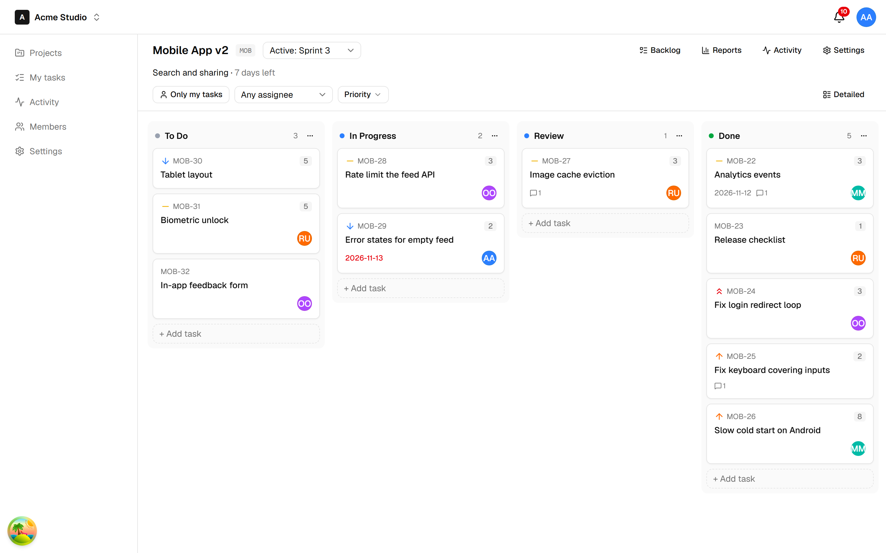
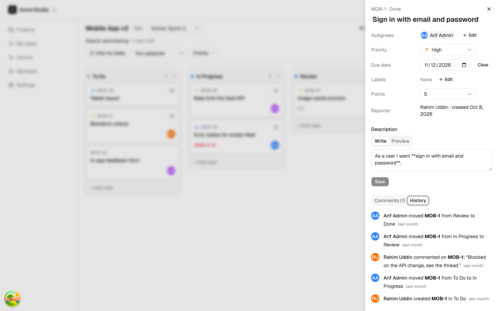
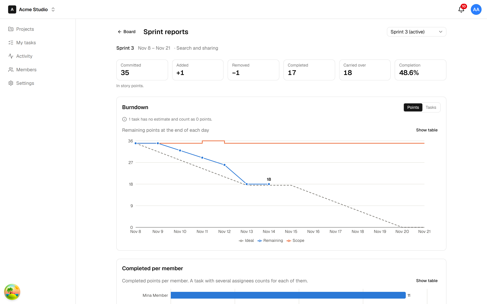

# TeamBoard

A multi-tenant project management app (think a small Jira/Trello): workspaces with four roles, Kanban boards with drag and drop, real-time sync between browsers, sprints, and burndown reports. TypeScript end to end: React, Express, MongoDB, Socket.io.

**Live demo:** https://teamboard-yaur.onrender.com
Log in as `owner@`, `admin@`, `member@` or `viewer@demo.teamboard.dev`, password `Demo1234!`, and open two browsers side by side.
Free hosting sleeps when idle: the first load can take ~40 s.



| Task drawer: fields, Markdown, comments, history | Sprint report: burndown and completed per member |
| ------------------------------------------------ | ------------------------------------------------ |
|                   |                |

## What it does

- **Workspaces** (tenants) with invite links and four roles: Owner, Admin, Member, Viewer. Every screen adapts to the role, and the API enforces it.
- **Boards:** columns, drag and drop with mouse, touch or keyboard, filters in the URL, a task drawer with Markdown, comments and a full history.
- **Real time:** a card moved in one browser moves in every other open browser within a second. So do comments, columns and role changes.
- **Sprints:** plan in the backlog, start with a scope snapshot, complete with carry-over.
- **Reports:** a burndown (actual vs ideal, in points or tasks), completed work per member, and a sprint summary. A completed sprint's report is frozen.
- **Activity feeds and notifications:** every change is recorded as structured data and rendered as sentences on the client. A notification bell updates live.

## The hard problems, and how they are solved

1. **Tenant isolation.** The tenant comes from the URL slug plus a membership lookup, never from the request body. A Mongoose plugin throws on any query without `workspaceId`. Another tenant's data answers 404, not 403, so its existence never leaks. A test suite attacks every route from a foreign workspace, and a coverage test fails if a new route has no attack.
2. **Authorization.** One permission map is shared by the API and the UI. The role is read from the database on every request. "You can't promote someone above yourself" is part of the update's filter, so it holds even under concurrent requests. An auto-generated matrix tests every route × every role.
3. **Card ordering.** Fractional-index ranks: a move writes exactly one document. The server computes the rank, ranks are unique per column (a unique index plus retry), and moves use compare-and-set on a version. A property test runs 1,000 random moves.
4. **Real-time sync.** Socket.io rooms per user, workspace and board. Events are broadcast only after the transaction commits. Each tab ignores its own echo (a mutation id). Out-of-order events are dropped by version. After a reconnect, the client refetches.
5. **Burndown that is correct by construction.** Every change that affects a running sprint stores its _effect_ (`scopeDelta`, `doneDelta`). The chart is a MongoDB pipeline (`$dateToString` in the workspace's timezone + `$setWindowFields`) plus a pure TypeScript function that fills in the calendar. A hand-calculated fixture is checked into the tests.
6. **Concurrency.** Atomic counters for task and sprint numbers. Transactions for multi-document changes. A partial unique index allows only one active sprint per project. A "touch the sprint" lock turns a read-write race (a task added while the sprint starts) into a write conflict that MongoDB resolves. Deterministic tests prove each race is closed.

## Architecture

```
Browser (React SPA)
  TanStack Query cache  ◄──  Socket.io client      dnd-kit · Radix · Recharts
        │ HTTPS (REST)              │ WSS
        ▼                           ▼
Node.js API (Express 5), one origin with the SPA
  helmet (strict CSP) → rate limits → authenticate (JWT)
    → resolveWorkspace (tenant from URL + membership) → authorize(permission)
    → validate (Zod, shared with the client) → service
  service: transaction { change + activity record } → commit → publish(domain events)
                                                                ├─► socket broadcaster
                                                                └─► notifier
        │ Mongoose (tenant guard plugin)
        ▼
MongoDB (replica set: transactions)
```

A TypeScript monorepo (npm workspaces): `apps/api`, `apps/web`, and `packages/shared`, which holds the Zod schemas, DTOs, socket event types and the permission map used by both sides.

## Run it locally

Requires Node 22+ and Docker.

```bash
npm install
npm run db:up && npm run seed -w @teamboard/api
npm run dev   # http://localhost:5173
```

`apps/api/.env.example` lists the settings. The seed creates the same demo workspace as the live site, with three sprints of realistic history.

## Tests

| Suite                                                       | What it proves                                                                     |
| ----------------------------------------------------------- | ---------------------------------------------------------------------------------- |
| API integration (Vitest + an in-memory MongoDB replica set) | every endpoint, with real transactions                                             |
| Cross-tenant                                                | every tenant route returns 404 to a foreign workspace and to foreign ids           |
| RBAC matrix                                                 | every route × Owner / Admin / Member / Viewer / non-member                         |
| Real time                                                   | handshake auth, room checks, broadcasts only after commit, forced leave on removal |
| Ordering                                                    | 1,000 random moves keep ranks unique and ordered                                   |
| Burndown                                                    | the hand-calculated fixture, timezone bucketing, frozen reports                    |
| Web unit                                                    | cache patching, drop logic, keyboard drag, activity rendering                      |
| Playwright E2E                                              | two browsers in sync, the Viewer is read-only, a sprint from completion to report  |

```bash
npm test                    # API + web
npm run e2e -w @teamboard/web   # needs Docker (re-seeds the demo first)
```

CI runs lint, formatting, typecheck, all tests and the production build, then the E2E job.

## Trade-offs (what I'd revisit at scale)

- **One server instance.** Socket.io would need the Redis adapter to run several.
- **Missed socket events aren't replayed.** A reconnecting client refetches what it shows instead.
- **Free MongoDB Atlas tier:** no point-in-time backups.
- **Access token in memory, refresh token in an HttpOnly cookie.** The cookie rotates on every use, and reuse of an old one revokes the whole session family.
- **Password-reset emails** are logged on the server, not sent.
